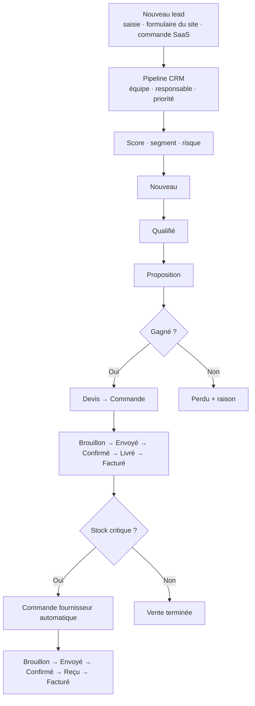

# 📈 Flowmerce ERP — Modules Odoo 19 (CRM · Ventes · Achats · Boutique SaaS)

> Quatre modules Odoo 19 qui couvrent tout le cycle **Lead → Opportunité → Devis → Commande → Facture → Achat** d'une entreprise de logiciels ou de distribution, avec **scoring explicable des leads**, segmentation client, détection de risque, suivi des marges, score fournisseur, réapprovisionnement automatique selon le stock et une **boutique en ligne qui vend des licences SaaS**.

🇬🇧 [English version](README.md)


---

## 📌 Présentation

Le CRM standard d'Odoo indique *où* en est une affaire, pas *quelles* affaires méritent l'attention aujourd'hui. Ces modules ajoutent une petite couche d'aide à la décision au pipeline : chaque lead reçoit un score de 0 à 100, un segment client et un niveau de risque calculés par des règles simples et documentées. Ils la relient aux ventes, aux achats, à un stock simulé et à une boutique en ligne :

1. un lead arrive (saisi à la main ou via le formulaire du site) et il est **noté, segmenté et évalué** automatiquement ;
2. une fois gagné, un **devis** est créé ; la commande suit les **marges** et le **statut de paiement** ;
3. quand un produit passe sous son seuil d'alerte, une **commande fournisseur** peut être générée automatiquement, et les fournisseurs sont **notés** selon leur fiabilité de livraison ;
4. sur la boutique, l'achat d'un produit SaaS **envoie une clé de licence par e-mail**, ouvre un lead d'intégration dans le CRM et affiche la licence dans le portail client jusqu'à son **expiration**.

## 🧩 Modules

| Module | Rôle | Dépend de |
|---|---|---|
| [`crm_mt`](crm_mt/) | Pipeline CRM, scoring, segmentation, risque, stock simulé, pipelines internes de devis / achats, automatisations, groupes de sécurité | `base`, `mail`, `utm`, `product` |
| [`flowmerce_sale`](flowmerce_sale/) | Devis et commandes, marges, statut de paiement, assistant de facturation, rapport PDF, tableaux de bord | `crm_mt`, `product`, `uom` |
| [`flowmerce_purchase`](flowmerce_purchase/) | Commandes fournisseurs, score fournisseur, risque de retard, commande automatique, tableaux de bord | `crm_mt`, `product`, `uom` |
| [`logismart_website`](logismart_website/) | Catalogue SaaS, licences, portail client (`/my/licenses`), formulaire de contact → lead CRM, modèles d'e-mail | `website`, `website_sale`, `sale_management`, `crm_mt` |

## ✨ Fonctionnalités et règles métier

### CRM (`crm_mt`, modèle `crm.mt.lead`)

**Score du lead (0–100)**, recalculé automatiquement et par une tâche quotidienne :

| Critère | Points |
|---|---|
| Priorité normale / haute / très haute | 5 / 15 / 25 |
| Revenu attendu (échelle logarithmique) | jusqu'à 25 |
| Dernière activité < 7 / < 30 / < 60 jours | 20 / 10 / 5 |
| Contact renseigné · étape renseignée | +10 · +10 |
| Probabilité | probabilité ÷ 5 (jusqu'à 20) |

**Segment** : `VIP` (score ≥ 75 ou revenu ≥ 50 000) · `Fidèle` (score ≥ 55 et actif depuis moins de 30 jours) · `Froid` (inactif depuis 60 jours ou score < 20) · `À risque` (en cours et inactif depuis 30 jours) · `Nouveau`.

**Niveau de risque** : des points pour un score faible (+2), 30 jours sans activité (+2), une date de clôture dépassée (+3) et une probabilité inférieure à 20 % (+1) ; `élevé` à partir de 5, `moyen` à partir de 2. Les leads à risque élevé reçoivent une alerte dans leur fil de discussion.

Aussi : pipeline kanban avec étapes (Nouveau → Qualifié → Proposition → Gagné / Perdu), équipes, raisons de perte (trop cher, concurrent, pas de réponse…), bouton « recalculer l'IA », marquer gagné / perdu, création d'un devis depuis un lead, tableaux de bord CRM et stock (graphique, pivot).

**Stock simulé** (`crm.mt.product.stock`) : quantités disponible, réservée et nette par produit, statut `ok / bas / critique / rupture` selon un seuil d'alerte, fonctions de réservation et de libération, et création automatique d'une commande fournisseur pour les articles critiques.

### Ventes (`flowmerce_sale`, modèle `flowmerce.sale.order`)
- Devis → envoyé → confirmé → livré → facturé, avec contrôles (pas de confirmation sans lignes) et messages dans le fil.
- **Marge** par ligne et par commande (prix − prix de revient, repris du produit), taux de marge, remise globale.
- **Statut de paiement** non payé / partiellement payé / payé, assistant de facturation, rapport imprimable, tableaux de bord chiffre d'affaires et marge.
- Tâche hebdomadaire : relance des devis en attente depuis plus de 7 jours.

### Achats (`flowmerce_purchase`, modèle `flowmerce.purchase.order`)
- Demande de prix → commande → reçue → facturée, remises par ligne.
- **Score fournisseur (0–100)** : fournisseur renseigné (+20), commande confirmée (+20), livraison à l'heure (+40, en retard +10), montant > 1 000 (+10) et > 10 000 (+10).
- **Risque de retard** : date prévue dépassée (+3) ou imminente (+2), aucune date (+1), score fournisseur faible (+2) → `élevé` à partir de 4, `moyen` à partir de 2.
- Tâche quotidienne : confirmation automatique des commandes marquées *commande automatique* ; tableaux de bord des dépenses par fournisseur et des risques.

### Boutique SaaS (`logismart_website`)
- Produits marqués **logiciel SaaS** avec version, liste de fonctionnalités et **durée de licence** (en jours, 0 = à vie).
- La confirmation d'une commande **crée une licence par ligne SaaS** (clé UUID, dates d'activation et d'expiration), **l'envoie par e-mail** au client et ouvre un **lead d'intégration** dans `crm_mt`.
- **Portail client** `/my/licenses` (chaque client ne voit que ses licences), pages catalogue et fiche logiciel, sections de la page d'accueil, formulaire de contact qui crée un lead CRM.
- **Score de santé SaaS** par client (a déjà acheté, possède une licence active, possède plusieurs licences) et boutons de navigation entre clients, produits, commandes et licences.
- Tâche quotidienne : fermeture automatique des licences expirées.

### Sécurité
- Groupes **Utilisateur / Ventes / Achats / Manager** avec droits d'accès et règles d'enregistrement (un commercial voit ses commandes, un manager voit tout, un client du portail voit ses licences).

## 🔁 Processus CRM et ventes



## 🚀 Installation

1. Copier les dossiers des modules dans un répertoire de l'`addons_path` d'Odoo 19.
2. Redémarrer Odoo, activer le mode développeur puis **Mettre à jour la liste des applications**.
3. Installer `crm_mt`, puis `flowmerce_sale` et `flowmerce_purchase`, puis `logismart_website` pour la boutique.

> Les modèles personnalisés ont leur propre espace de noms (`flowmerce.sale.order`, `flowmerce.purchase.order`…) : ces modules s'installent **à côté** des applications officielles Ventes et Achats d'Odoo.

## ✅ Tests

13 tests Odoo (`TransactionCase`) couvrent la formule du score et les segments, les marges et la numérotation, la relance des devis, le score fournisseur et le risque de retard, la confirmation automatique, la création des licences, leur expiration et le lead d'intégration. Ils tournent sur une base **Odoo 19** neuve avec les applications officielles *Ventes*, *Achats* et *eCommerce*, sans erreur ni avertissement :

```bash
docker run -d --name db -e POSTGRES_USER=odoo -e POSTGRES_PASSWORD=odoo -e POSTGRES_DB=postgres postgres:16
docker run --rm --link db -v "$PWD:/mnt/extra-addons" odoo:19 -- -d test --with-demo --stop-after-init \
  -i sale_management,purchase,website_sale,crm_mt,flowmerce_sale,flowmerce_purchase,logismart_website \
  --test-enable --test-tags=/crm_mt,/flowmerce_sale,/flowmerce_purchase,/logismart_website
# → 0 failed, 0 error(s) of 13 tests
```

## 📁 Structure

```
crm_mt/              modèles · vues (kanban, formulaire, tableaux de bord) · données (étapes, automatisations) · sécurité · tests
flowmerce_sale/      modèles · vues · assistant · rapport · données (séquence, démo, relance) · tests
flowmerce_purchase/  modèles · vues · données (séquence, démo, confirmation automatique) · contrôleurs · tests
logismart_website/   modèles · pages du site et du portail · modèles d'e-mail · tâches · sécurité · tests
```

## 👤 Auteur

**Mohamed Triki** — [GitHub](https://github.com/MohamedTrikii)
