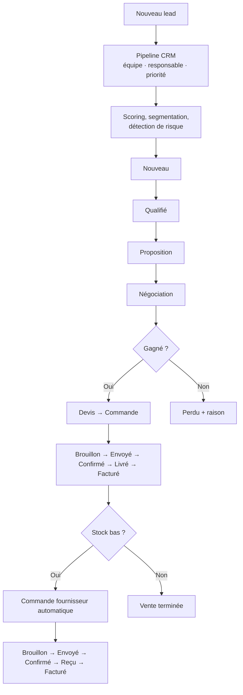

# 📈 Flowmerce ERP — Modules Odoo 19 (CRM · Ventes · Achats · eCommerce)

> Un ensemble de modules Odoo 19 qui couvre tout le cycle **Lead → Opportunité → Devis → Commande → Facture → Achat**, avec **scoring des leads**, segmentation client, détection de risque, réapprovisionnement automatique selon le stock et boutique en ligne de licences SaaS.

🇬🇧 [English version](README.md)


---

## 🧩 Modules

| Module | Rôle | Dépend de |
|---|---|---|
| [`crm_mt`](crm_mt/) | Pipeline CRM, scoring, segmentation, simulation de stock, automatisations | `base`, `mail`, `utm`, `product` |
| [`sale`](sale/) | Devis et commandes, marges, statut de paiement, assistant de facturation | `crm_mt`, `product`, `uom` |
| [`purchase`](purchase/) | Commandes fournisseurs, score fournisseur, risque de retard, commande automatique | `crm_mt`, `product`, `uom` |
| [`logismart_website`](logismart_website/) | Site web et eCommerce de licences SaaS, portail client (`/my/licenses`), formulaire de contact → lead CRM | `website`, `website_sale`, `crm_mt` |

## ✨ Points forts

**CRM (`crm_mt`, modèle `crm.mt.lead`)**
- `lead_score` (0–100) calculé à partir de la priorité, du revenu attendu, de la date de dernière activité, de l'étape et du partenaire.
- **Segmentation** automatique (VIP / Fidèle / À risque / Nouveau / Froid) et **niveau de risque** (faible / moyen / élevé).
- Pipeline kanban avec étapes, équipes, raisons de perte et chatter.
- **Simulation de stock** (`crm.mt.product.stock`) : quantités disponible / réservée / nette, avec déclenchement automatique d'un achat.

**Ventes (`sale`)** : **marges** par ligne et par commande, prix de revient repris du produit, remise globale, statut de paiement (non payé / partiel / payé), confirmation et facturation automatiques, tableaux de bord chiffre d'affaires et marge.

**Achats (`purchase`)** : **score fournisseur** (0–100), estimation du **risque de retard**, commande automatique confirmée par une tâche planifiée, remises par ligne, tableaux de bord des dépenses et des risques.

**Automatisations** : tâches planifiées de relance des devis en attente, recalcul des scores, détection des leads à risque, contrôle du stock bas, confirmation automatique des commandes fournisseurs marquées.

**Sécurité** : groupes utilisateur / ventes / achats / manager avec règles d'enregistrement.

## 🔁 Processus CRM et ventes



## 🚀 Installation

1. Copier les dossiers des modules dans un répertoire de l'`addons_path` d'Odoo 19.
2. Redémarrer Odoo, activer le mode développeur puis **Mettre à jour la liste des applications**.
3. Installer dans l'ordre : `crm_mt` → `sale` → `purchase` → `logismart_website`.

> ⚠️ `sale` et `purchase` portent les mêmes noms techniques que les modules officiels d'Odoo : utilisez-les sur une base **sans** les applications Ventes / Achats standard, ou renommez-les avant de combiner les deux.

## 📁 Structure

```
crm_mt/              modèles · vues (kanban, formulaire, tableaux de bord) · données (automatisations) · sécurité
sale/                modèles · vues · assistant · rapport · données (séquences, démo)
purchase/            modèles · vues · données · contrôleurs
logismart_website/   modèles de pages web · portail · licences SaaS · modèles d'e-mail · tâches planifiées
```

## 👤 Auteur

**Mohamed Triki** — [GitHub](https://github.com/MohamedTrikii)
