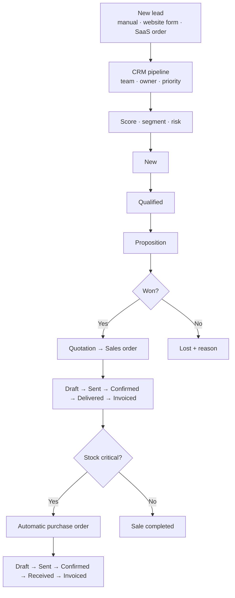

# 📈 Flowmerce ERP — Custom Odoo 19 Modules (CRM · Sales · Purchase · SaaS e-shop)

> Four Odoo 19 modules that cover the full **Lead → Opportunity → Quotation → Order → Invoice → Purchase** cycle of a software / distribution company, with **explainable lead scoring**, customer segmentation, risk detection, margin tracking, supplier scoring, stock-driven auto-purchasing and a **web shop that sells SaaS licences**.

🇫🇷 [Version française](README.fr.md)


---

## 📌 Overview

Odoo's standard CRM tells you *where* a deal is, not *which* deals deserve attention today. These modules add a small decision layer on top of the pipeline — every lead gets a 0–100 score, a customer segment and a risk level computed from simple, documented rules — and connect it to sales, purchasing, a simulated stock and an online shop:

1. a lead arrives (manually or from the website contact form) and is **scored, segmented and risk-rated** automatically;
2. when it is won, a **quotation** is created; the sales order tracks **margins** and **payment status**;
3. when a product falls below its alert threshold, a **purchase order** can be generated automatically, and suppliers are **scored** on their delivery reliability;
4. on the web shop, buying a SaaS product **issues a licence key by email**, opens an onboarding lead in the CRM and shows the licence in the customer portal until it **expires**.

## 🧩 Modules

| Module | Purpose | Depends on |
|---|---|---|
| [`crm_mt`](crm_mt/) | CRM pipeline, scoring, segmentation, risk, simulated stock, internal quote / purchase pipelines, automations, security groups | `base`, `mail`, `utm`, `product` |
| [`flowmerce_sale`](flowmerce_sale/) | Quotations & sales orders, margins, payment status, invoice wizard, PDF report, dashboards | `crm_mt`, `product`, `uom` |
| [`flowmerce_purchase`](flowmerce_purchase/) | Purchase orders, supplier score, delivery-risk, auto-order, dashboards | `crm_mt`, `product`, `uom` |
| [`logismart_website`](logismart_website/) | SaaS catalogue, licences, customer portal (`/my/licenses`), contact form → CRM lead, e-mail templates | `website`, `website_sale`, `sale_management`, `crm_mt` |

## ✨ Features & business rules

### CRM (`crm_mt`, model `crm.mt.lead`)

**Lead score (0–100)** — recomputed automatically and by a daily job:

| Criterion | Points |
|---|---|
| Priority normal / high / very high | 5 / 15 / 25 |
| Expected revenue (log scale) | up to 25 |
| Last activity < 7 / < 30 / < 60 days | 20 / 10 / 5 |
| Contact set · stage set | +10 · +10 |
| Probability | probability ÷ 5 (up to 20) |

**Segment** — `VIP` (score ≥ 75 or revenue ≥ 50 000) · `Loyal` (score ≥ 55 and active in the last 30 days) · `Cold` (inactive ≥ 60 days or score < 20) · `At-Risk` (pending and inactive ≥ 30 days) · `New`.

**Risk level** — points for a low score (+2), 30 days without activity (+2), a missed closing date (+3) and a probability under 20 % (+1): `high` from 5, `medium` from 2. High-risk leads receive an alert in their chatter.

Also: Kanban pipeline with stages (New → Qualified → Proposition → Won / Lost), teams, lost reasons (too expensive, competitor, no response…), one-click "recompute AI", mark won / lost, create quotation from a lead, and CRM + stock dashboards (graph, pivot).

**Simulated stock** (`crm.mt.product.stock`) — available, reserved and net quantity per product, status `ok / low / critical / out` against an alert threshold, reserve / release helpers, and automatic creation of a purchase order for critical items.

### Sales (`flowmerce_sale`, model `flowmerce.sale.order`)
- Quotation → sent → confirmed → delivered → invoiced, with validation (no confirmation without lines) and chatter messages.
- **Margin** per line and per order (price − cost price, cost auto-filled from the product), margin rate, global discount.
- **Payment status** unpaid / partially paid / paid, invoice wizard, printable quotation / order report, revenue & margin dashboards.
- Weekly job: reminder on quotations pending for more than 7 days.

### Purchase (`flowmerce_purchase`, model `flowmerce.purchase.order`)
- RFQ → purchase order → received → invoiced, line discounts.
- **Supplier score (0–100)**: supplier set (+20), order confirmed (+20), delivered on time (+40, late +10), amount > 1 000 (+10) and > 10 000 (+10).
- **Delivery risk**: late (+3) or imminent (+2) expected date, no date (+1), weak supplier score (+2) → `high` from 4, `medium` from 2.
- Daily job: automatic confirmation of orders flagged *auto-order*; spend-by-supplier and risk dashboards.

### SaaS e-shop (`logismart_website`)
- Products flagged as **SaaS software** with version, feature list and **licence duration** (days, 0 = lifetime).
- Confirming an order **creates one licence per SaaS line** (UUID key, activation and expiration dates), **e-mails it** to the customer and opens an **onboarding lead** in `crm_mt`.
- **Customer portal** `/my/licenses` (each customer only sees their own licences), software catalogue and detail pages, home-page sections, contact form that creates a CRM lead.
- **SaaS health score** per customer (has bought, has an active licence, has several licences) and smart buttons between customers, products, orders and licences.
- Daily job: expired licences are closed automatically.

### Security
- Groups **User / Sales / Purchase / Manager** with access rights and record rules (sales users see their own orders, managers see everything, portal users see their own licences).

## 🔁 CRM & sales process



## 🚀 Installation

1. Copy the module folders into a directory of your Odoo 19 `addons_path`.
2. Restart Odoo, enable developer mode and click **Update Apps List**.
3. Install `crm_mt`, then `flowmerce_sale` and `flowmerce_purchase`, then `logismart_website` for the web shop.

> The custom models are namespaced (`flowmerce.sale.order`, `flowmerce.purchase.order`…), so these modules install **alongside** Odoo's official Sales and Purchase apps.

## ✅ Tests

13 Odoo tests (`TransactionCase`) cover the lead-score formula and segments, margins and sequences, the quotation reminder, supplier score and delivery risk, auto-confirmation, licence creation, expiration and the onboarding lead. They run on a fresh **Odoo 19** database together with the official *Sales*, *Purchase* and *eCommerce* apps — no error, no warning:

```bash
docker run -d --name db -e POSTGRES_USER=odoo -e POSTGRES_PASSWORD=odoo -e POSTGRES_DB=postgres postgres:16
docker run --rm --link db -v "$PWD:/mnt/extra-addons" odoo:19 -- -d test --with-demo --stop-after-init \
  -i sale_management,purchase,website_sale,crm_mt,flowmerce_sale,flowmerce_purchase,logismart_website \
  --test-enable --test-tags=/crm_mt,/flowmerce_sale,/flowmerce_purchase,/logismart_website
# → 0 failed, 0 error(s) of 13 tests
```

## 📁 Structure

```
crm_mt/              models · views (kanban, form, dashboards) · data (stages, automations) · security · tests
flowmerce_sale/      models · views · wizard · report · data (sequence, demo, reminder job) · tests
flowmerce_purchase/  models · views · data (sequence, demo, auto-confirm job) · controllers · tests
logismart_website/   models · website & portal templates · e-mail templates · jobs · security · tests
```

## 👤 Author

**Mohamed Triki** — [GitHub](https://github.com/MohamedTrikii)
