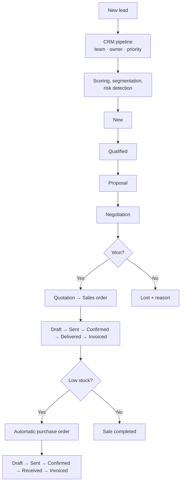

# 📈 Flowmerce ERP — Custom Odoo 19 Modules (CRM · Sales · Purchase · eCommerce)

> A set of Odoo 19 modules covering the full **Lead → Opportunity → Quotation → Order → Invoice → Purchase** cycle, with **lead scoring**, customer segmentation, risk detection, stock-driven auto-purchasing and a SaaS-licence web shop.

🇫🇷 [Version française](README.fr.md)


---

## 🧩 Modules

| Module | Purpose | Depends on |
|---|---|---|
| [`crm_mt`](crm_mt/) | CRM pipeline, scoring, segmentation, stock simulation, automations | `base`, `mail`, `utm`, `product` |
| [`sale`](sale/) | Quotations & sales orders, margins, payment status, invoice wizard | `crm_mt`, `product`, `uom` |
| [`purchase`](purchase/) | Purchase orders, supplier scoring, delivery risk, auto-order | `crm_mt`, `product`, `uom` |
| [`logismart_website`](logismart_website/) | Website & eCommerce for SaaS licences, customer portal (`/my/licenses`), contact form → CRM lead | `website`, `website_sale`, `crm_mt` |

## ✨ Highlights

**CRM (`crm_mt`, model `crm.mt.lead`)**
- `lead_score` (0–100) computed from priority, expected revenue, activity recency, stage and partner.
- Automatic **segmentation** (VIP / Loyal / At-Risk / New / Cold) and **risk level** (Low / Medium / High).
- Kanban pipeline with stages, teams, lost reasons and chatter.
- **Stock simulation** (`crm.mt.product.stock`): available / reserved / net quantity with an automatic purchase trigger.

**Sales (`sale`)** — line and order **margins**, cost price auto-filled from the product, global discount, payment status (unpaid / partial / paid), automatic confirmation and invoicing, revenue & margin dashboards.

**Purchase (`purchase`)** — **supplier score** (0–100), **delivery-risk** prediction, auto-order flag confirmed by cron, line discounts, spend & risk dashboards.

**Automations** — scheduled actions: stale-quotation follow-up, lead-score recomputation, high-risk lead detection, low-stock check, auto-confirmation of flagged purchase orders.

**Security** — user / sales / purchase / manager groups with record rules.

## 🔁 CRM & sales process



## 🚀 Installation

1. Copy the module folders into a directory of your Odoo 19 `addons_path`.
2. Restart Odoo, enable developer mode and click **Update Apps List**.
3. Install in this order: `crm_mt` → `sale` → `purchase` → `logismart_website`.

> ⚠️ `sale` and `purchase` share their technical names with Odoo's official modules: use them on a database **without** the standard Sales / Purchase apps, or rename them before combining both.

## 📁 Structure

```
crm_mt/              models · views (kanban, form, dashboards) · data (automations) · security
sale/                models · views · wizard · report · data (sequences, demo)
purchase/            models · views · data · controllers
logismart_website/   website templates · portal · SaaS licences · email templates · cron jobs
```

## 👤 Author

**Mohamed Triki** — [GitHub](https://github.com/MohamedTrikii)
